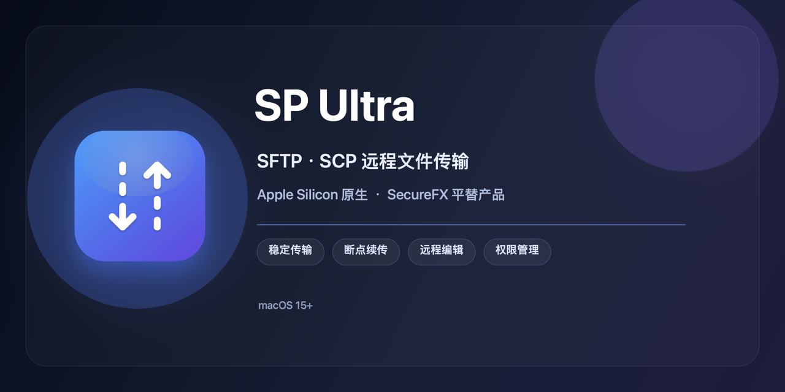

# SP Ultra

<p align="center">
  
</p>

**SP Ultra 是一款支持 SFTP 与 SCP 远程传输协议的 macOS 软件，也是面向 Apple Silicon 的 SecureFX 平替产品。**

它采用原生 SwiftUI 双栏界面和应用内 SwiftNIO SSH 协议栈，不调用系统 `ssh`、`sftp` 或 `scp` 命令。普通云服务器、Linux/macOS 主机以及仅提供 SCP 的旧设备或越狱 iOS，都可以使用同一个快速连接窗口。

## 功能

- SFTP 与 SCP 双协议，连接、认证和传输均由应用内 Swift 库完成。
- SecureFX 风格的本地/远程双栏浏览、拖拽上传下载和会话管理。
- 密码及加密私钥口令存入 macOS 钥匙串；未加密私钥不会触发多余的钥匙串读取。
- TOFU 主机指纹校验；指纹库损坏时可从“连接”菜单备份并受控重置。
- SCP 自动兼容旧版 SSH 算法，不再提供独立的 iOS 连接入口。
- 用户自定义初始远程路径列表；首次启动只包含 `/`，可自行添加或移除路径。
- 远程创建、删除、重命名、权限编辑，以及不超过 4 MB 的 UTF-8 文本在线编辑。
- 实时上传/下载总进度、单任务字节进度和传输速度。
- SFTP 上传与下载断点续传；续传前抽样校验本地与远程部分内容。
- 目录上传自动跳过符号链接并写入日志，避免循环和半上传失败。
- 内嵌 stdio MCP 服务，方便自动化读取远程目录。

## 系统要求

- Apple Silicon Mac（M1 或更新）
- macOS 15.0 或更新

## 安装

1. 从 [Releases](https://github.com/GoAroundADI/SP-Ultra/releases/latest) 下载 `SPUltra-1.0.0-arm64.dmg`。
2. 打开 DMG，将 **SP Ultra** 拖入 **Applications**。
3. 如果使用 ad-hoc 签名包时被 Gatekeeper 阻止，可在确认下载来源后执行：

```bash
xattr -dr com.apple.quarantine "/Applications/SP Ultra.app"
```

## 连接

点击“快速连接”，选择 SFTP 或 SCP，然后填写主机、端口、用户名和认证信息。

- 常规服务器优先使用 SFTP。
- 不提供 SFTP 子系统的主机使用 SCP。SCP 会自动使用兼容算法重试，无需单独选择 iOS 模式。
- 初始远程目录默认只有 `/`。输入常用路径后点击“添加”，路径会保存在本机列表中。
- 首次连接会记录主机指纹；指纹变化时必须核实后才能更新。

## 安全设计

- 不调用系统 SSH/SCP 命令行工具。
- 密码仅保存在 macOS 钥匙串；会话与指纹文件权限固定为 `0600`。
- GUI 与 MCP 使用独立的主机指纹库。
- SCP 文件名拒绝换行、回车、NUL 与路径分隔符，避免协议头注入。
- 删除、重命名和权限命令使用 shell 转义，并兼容不支持 `--` 的旧版工具。

## 构建与测试

```bash
git clone https://github.com/GoAroundADI/SP-Ultra.git
cd SP-Ultra
swift build
swift test
zsh scripts/package-app.sh
zsh scripts/package-dmg.sh
```

真实 SSH 集成测试为可选测试：

```bash
SPULTRA_TEST_HOST=127.0.0.1 \
SPULTRA_TEST_PORT=22 \
SPULTRA_TEST_USER=root \
SPULTRA_TEST_PASSWORD='password' \
SPULTRA_TEST_REMOTE_DIR=/tmp \
swift test --filter NativeSSHIntegrationTests
```

只有目标确实提供 SFTP 子系统时才额外设置 `SPULTRA_TEST_SFTP=1`。

## MCP

App 内置 MCP 可执行文件：

```text
/Applications/SP Ultra.app/Contents/MacOS/SPUltraMCP
```

详细配置见 [MCP_SETUP.md](MCP_SETUP.md)。

## 协议限制

- 标准 SCP 协议没有安全的随机偏移续传能力，因此断点续传仅用于 SFTP。
- 在线编辑仅支持不超过 4 MB 的 UTF-8 文本文件。
- 当前发布包使用 ad-hoc 签名，尚未进行 Apple Developer ID 公证。

## 作者与许可证

SP Ultra 由 **Go Around ADI** 开发和维护，按 [MIT License](LICENSE) 开源。

- 项目：<https://github.com/GoAroundADI/SP-Ultra>
- 问题反馈：<https://github.com/GoAroundADI/SP-Ultra/issues>
