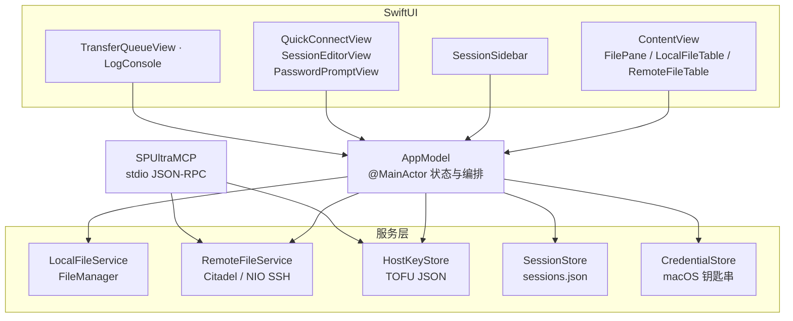

# 架构说明

本文说明 SP Ultra 的整体结构、状态存放位置，以及扩展时需要改动的部分。

## 目标

- 原生的 macOS 双栏文件管理体验，作为 SecureFX 在 macOS 上的平替。
- 完全掌控 SSH：不调用系统 `ssh`、`sftp`、`scp`，也不读写 `known_hosts`。
- 同时适配完整服务器（SFTP）与精简越狱设备（SCP），方便逆向与设备调试。
- 密码放进钥匙串，主机密钥的信任必须明确。
- 网络慢或目录很大时，界面仍然保持响应。

## 分层

| 组件 | 职责 |
| --- | --- |
| `AppModel` | 连接状态机、会话保存/加载、远程缓存、传输队列、日志、密码缓存、密码输入窗口状态 |
| `RemoteFileService` | SFTP/SCP 连接、目录列表、创建/删除、上传/下载、主机密钥校验 |
| `LocalFileService` | 本地目录枚举 |
| `HostKeyStore` | TOFU 主机密钥存储、变化检测、显式替换 |
| `SessionStore` | `sessions.json` 持久化 |
| `CredentialStore` | 通过 `CredentialStoring` 协议封装钥匙串读写 |
| `SPUltraMCP` | 独立的 stdio MCP 服务，拥有自己的主机密钥与内存密码 |

## 连接生命周期

1. `AppModel.connect(profile:password:savePassword:)` 校验配置、解析可复用的会话 ID，并启动任务。
2. 如果没有传入密码，`RemoteFileService` 会从钥匙串（或内存缓存）读取，并在日志中提示 macOS 授权框。
3. `RemoteFileService.test(configuration:)`：
   - 等待上一次连接遗留的关闭任务；
   - 创建绑定到 `host:port` 的 `ApplicationHostKeyValidator`；
   - 构建 `SSHClientSettings`；现代算法失败时自动使用完整兼容算法集重试；
   - 连接并完成认证；
   - 打开 SFTP（`openSFTP` + `getRealPath`），或用 `pwd` 验证 SCP 的 exec 通道。
4. `AppModel` 加载初始远程目录、标记连接成功，并按需持久化会话。
5. 失败时把握手错误转换成可读提示；瞬态握手失败重试一次；认证失败不自动重试。
6. `disconnect()` 关闭 SFTP 与 SSH 客户端，等待挂起的关闭任务，清空缓存并更新 UI。

## SFTP 与 SCP

**SFTP** 使用 Citadel 的 `SFTPClient`：

- 目录列表返回结构化组件和 POSIX 权限；
- 文件通过 `withFile` 按偏移量流式读写；
- 删除目录时先递归列出并删除子项，再 `rmdir`。

**SCP** 用于没有 SFTP 子系统的服务器（也包括精简越狱 iOS），统一从普通快速连接入口进入：

- 通过 SSH exec 执行 `LC_ALL=C ls -lan '<path>'/.` 浏览目录；
- 上传使用 `scp -t` 和应用内 SCP 协议；
- 下载使用 `scp -f`，符号链接通过 `ls -ldn` 解析；
- 创建/删除使用 `mkdir`、`rm`，以及多级兜底的空文件创建。

### iOS 空文件创建

精简引导通常没有 `touch`，因此 `RemoteFileService.createFile` 依次尝试：

1. `: > '<path>'`（POSIX shell 内建），随后用 `ls -ldn` 校验；
2. 通过 SCP 协议上传一个 0 字节文件；
3. `touch '<path>'`，随后再次校验。

全部失败时，抛出的错误会包含每一次尝试和远端 stderr，UI 原样展示。

## 线程与性能

- `AppModel` 是 `@MainActor`；所有 `@Published` 状态都在主线程修改。
- 本地目录枚举在 `Task.detached` 中执行，返回 Sendable 结果；通过请求序号丢弃过期结果。
- 远程列表本身是异步的（Citadel 非隔离）。每个请求有独立序号，并用当前路径校验，避免旧结果覆盖新目录。
- 已访问的远程目录按路径缓存，切回时立即渲染，同时后台刷新。
- 本机名称只解析一次，不放在视图 body 中。
- 连接关闭会记录挂起的 Task，新连接开始前等待它们结束。
- 文件表的拖拽热区只覆盖图标/文件名，空白处交给 Table 原生行选中。
- 传输层通过线程安全的进度跟踪器按数据块回报字节数；`AppModel` 在主线程计算百分比和速度。
- SFTP 传输使用稳定的隐藏 `.spultra-part` 文件保存断点，完成后再替换正式目标；SCP 只提供实时进度。

## 持久化与密钥

| 数据 | 位置 |
| --- | --- |
| 会话 | `~/Library/Application Support/SP Ultra/sessions.json` |
| GUI 主机密钥 | `~/Library/Application Support/SP Ultra/host_keys.json` |
| MCP 主机密钥 | `~/Library/Application Support/SP Ultra/mcp_host_keys.json` |
| 密码 | macOS 钥匙串，服务 `com.spultra.credentials`，账户为会话 UUID |
| MCP 密码 | 仅进程内存 |

主机密钥以 OpenSSH 字符串比较，展示时计算 SHA-256 指纹。GUI 与 MCP 故意不共享密钥文件：MCP 客户端不能悄悄扩展 GUI 的信任。

## 安全边界

- SSH 在进程内运行，不对本地凭据做 shell 插值。
- 远程路径在交给远端 shell 前会做单引号转义。
- 主机密钥变化时默认拒绝，必须由用户显式操作。
- MCP 每次 `connect` 接收密码，不读取钥匙串、会话文件或 GUI 主机密钥。
- 本地使用 ad-hoc 签名；对外分发应使用 Developer ID 并公证。

## MCP

`SPUltraMCP` 是通过 stdio 传输的、按行分隔的 JSON-RPC 2.0 服务，支持 `initialize`、`ping`、`tools/list` 和 `tools/call`，工具包括：

- `connect`
- `list_directory`
- `connection_status`
- `disconnect`
- `reset_host_key`

工具定义与运维说明见 [MCP_SETUP.md](../MCP_SETUP.md)。

## 扩展点

- **新增远程操作**：在 `RemoteFileService` 中同时实现 SFTP/SCP 分支，在 `AppModel` 暴露入口，再接入菜单或工具栏。
- **新增持久化设置**：给 `SessionProfile` 增加带默认值的字段，保证旧 `sessions.json` 仍能解码，再在 `SessionForm` 中展示。
- **替换凭据后端**：实现 `CredentialStoring` 并注入 `AppModel`；测试中使用内存假实现。
- **新增 MCP 工具**：在 `MCPServer.handle` 增加 case，定义输入 schema，并更新 `MCP_SETUP.md`。

## 已知架构限制

- 同时只有一个远程连接；传输队列串行执行。
- SCP 协议不支持安全随机定位，当前仅 SFTP 支持断点续传。
- 在线编辑仅支持不超过 4 MB 的 UTF-8 文本文件。
- SCP 依赖远端的 `scp` 二进制和 POSIX shell。
- UI 以中文为主，目前使用内联字符串而非本地化资源。
